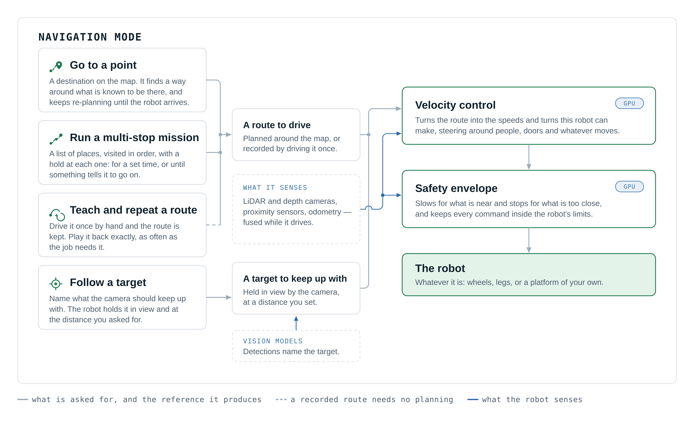
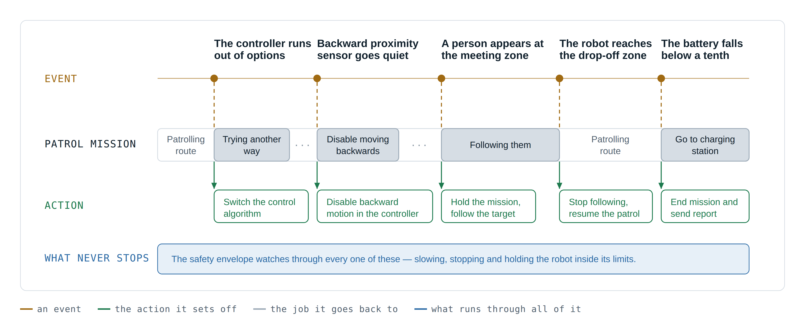

<div align="center">

<picture>
  <source media="(prefers-color-scheme: dark)" srcset="docs/_static/Kompass_dark.png">
  <source media="(prefers-color-scheme: light)" srcset="docs/_static/Kompass_light.png">
  
</picture>

<br/>

**GPU-accelerated, event-driven navigation for the real world**

[](LICENSE)
[](https://emos.automatikarobotics.com/getting-started/installation.html)
[](https://discord.gg/B9ZU6qjzND)

[**Documentation**](https://emos.automatikarobotics.com) · [**Developer Docs**](https://automatika-robotics.github.io/kompass/) · [**Discord**](https://discord.gg/B9ZU6qjzND)

</div>

---

<div align="center">
<picture>
  <source media="(prefers-color-scheme: dark)" srcset="docs/_static/images/diagrams/navigation_modes_dark.png">
  <source media="(prefers-color-scheme: light)" srcset="docs/_static/images/diagrams/navigation_modes_light.png">
  
</picture>
<br>
<sub>One system - Four configurable navigation modes.</sub>
</div>

**Kompass** is the navigation layer of [EMOS](https://github.com/automatika-robotics/emos), the Embodied Operating System. An event-driven navigation system, made for robots working in the real world.

Real environments don't hold still. People walk into the path, sensors drop out,
plans go stale, and a stack that is fixed at launch will soon fail. **Kompass adapts at runtime.** It swaps controllers, tightens safety limits, or reconfigures itself, all on the fly, with no relaunch needed.

Under the hood, every component runs on optimized C++ that executes on CPU or **any** GPU.

**Forget rigid behavior trees.** In Kompass, any complex behavior for your robot is a single Python script, a **Recipe**:
wire events to actions across the whole stack and describe how your robot should react,
in a few readable lines.

## Components

| Area | Components |
| :--- | :--- |
| **Planning** | **Planner** finds a path around the known map with OMPL, re-planning until the robot arrives, and records a route driven by hand so it can be played back later. **MissionManager** runs a list of waypoints in order, holding at each one for a set time or until a condition is met. |
| **Control** | **Controller** turns a route into the velocities this robot can make, steering around what moves: DWA, Stanley, Pure Pursuit and DVZ for path tracking, RGB and RGB-D followers for keeping a target in view at a distance you set. |
| **Perception** | **LocalMapper** fuses laser scans and point clouds into a local occupancy map while the robot drives. **MapServer** serves the static global map from a file, as a grid or a point cloud. |
| **Safety** | **DriveManager** is the last stop before the wheels: it limits every command to the robot's envelope, slows for what is near, stops for what is too close, and drives the robot out when it gets stuck. |
| **Testing** | **MotionServer** sends reference commands and records the resulting motion, for tuning and regression testing on a real robot. |

Learn more about each one in the [EMOS Documentation](https://emos.automatikarobotics.com):
[Planner](https://emos.automatikarobotics.com/kompass/navigation/path_planning.html) ·
[Controller](https://emos.automatikarobotics.com/kompass/navigation/control.html) ·
[Local Mapper](https://emos.automatikarobotics.com/kompass/navigation/mapper.html) ·
[Map Server](https://emos.automatikarobotics.com/kompass/navigation/map_server.html) ·
[Drive Manager](https://emos.automatikarobotics.com/kompass/navigation/driver.html) ·
[Motion Server](https://emos.automatikarobotics.com/kompass/navigation/motion_server.html)

## Key Features

- **A stack that rearranges itself.** Any component can react to what another one publishes. Switch the control algorithm when the current one runs out of options, disable backward motion when a proximity sensor goes quiet, or hold a mission and follow a person the moment a model sees one. Nothing is relaunched.
- **Engineered for speed.** The core algorithms are modern C++ ([kompass-core](https://github.com/automatika-robotics/kompass-core)), with GPU execution through GPGPU rather than a single vendor's toolkit, so the same recipe runs fast on an Nvidia Jetson, an AMD board or plain CPUs.
- **ML models as first-class citizens.** Any model output can drive an event — a detection, a tracked target, a decision model's answer, a VLM's reading of the scene — and reconfigure navigation exactly as a sensor reading would. Kompass and [EmbodiedAgents](https://github.com/automatika-robotics/embodied-agents), the intelligence layer of EMOS, are built on the same component framework, so one recipe can wire both into a single graph: perception, language and planning triggering navigation, and navigation triggering them back.
- **Hardware-agnostic.** Differential drive, Ackermann, omnidirectional and legged platforms share one robot configuration: geometry, velocity limits and acceleration limits. The control and safety path does not change with the chassis.
- **Pythonic API with native speed.** The heavy lifting stays in C++ while the recipe stays a readable Python file. Prototype and deploy without rewriting anything.

## Build Event-Driven Navigation Missions

<div align="center">
<picture>
  <source media="(prefers-color-scheme: dark)" srcset="docs/_static/images/diagrams/event_driven_dark.png">
  <source media="(prefers-color-scheme: light)" srcset="docs/_static/images/diagrams/event_driven_light.png">
  
</picture>
</div>

**One patrol with Kompass, four surprises, zero relaunches.**

Every reaction in the mission above is a line in its Recipe: an event paired with an action.

- **The active controller runs out of options** → switch to another one and keep going.
- **The rear proximity sensor goes quiet** → disable backward motion without pausing the mission.
- **A person is detected at a defined meeting zone** → switch to vision mode and follow them.
- **The drop-off zone is reached** → stop person following, pick the patrol route back up where it left off.

The safety envelope watches through all of it.

Here is the first reaction, added to the [Quick Start](#quick-start) recipe before `launcher.bringup()`:

```python
from automatika_ros_sugar.msg import ComponentStatus
from kompass.ros import Action, Event

# When DWA can't find a way forward, hand over to DVZ
controller_stuck = Event(
    controller.status_topic.msg.status
    == ComponentStatus.STATUS_FAILURE_ALGORITHM_LEVEL
)
launcher.on(
    controller_stuck,
    Action(
        method=controller.set_algorithm,
        kwargs={"algorithm_value": ControllersID.DVZ},
    ),
)
```


## Installation

The easiest way to get Kompass with the rest of the stack is the [EMOS CLI](https://github.com/automatika-robotics/emos#installation). See the [installation docs](https://emos.automatikarobotics.com/getting-started/installation.html) for details.

**Install kompass-core, with GPU support (recommended):**

```bash
curl -sSL https://raw.githubusercontent.com/automatika-robotics/kompass-core/refs/heads/main/build_dependencies/install_gpu.sh | bash
```

**Or with pip (CPU only):**

```bash
sudo apt-get install -y libompl-dev libfcl-dev && pip install kompass-core
```

**With your package manager (Ubuntu, ROS 2 Humble or later):**

```bash
sudo apt install ros-$ROS_DISTRO-kompass
```

**From source (after installing kompass-core above):**

```bash
mkdir -p kompass_ws/src && cd kompass_ws/src
git clone https://github.com/automatika-robotics/sugarcoat
git clone https://github.com/automatika-robotics/kompass
rosdep update && rosdep install -y --from-paths . --ignore-src
cd .. && colcon build
source install/setup.bash
```

## Quick Start

A navigation stack that takes goals from the web UI, plans around a map, tracks the path with DWA and keeps the robot inside its limits:

```python
import numpy as np
from kompass.components import Controller, DriveManager, LocalMapper, Planner
from kompass.control import ControllersID
from kompass.robot import (
    AngularCtrlLimits,
    LinearCtrlLimits,
    RobotConfig,
    RobotGeometryType,
    RobotType,
)
from kompass.ros import Launcher, Topic

my_robot = RobotConfig(
    model_type=RobotType.DIFFERENTIAL_DRIVE,
    geometry_type=RobotGeometryType.CYLINDER,
    geometry_params=np.array([0.1, 0.3]),  # radius, height
    ctrl_vx_limits=LinearCtrlLimits(max_vel=0.4, max_acc=1.5, max_decel=2.5),
    ctrl_omega_limits=AngularCtrlLimits(
        max_omega=0.4, max_acc=2.0, max_decel=2.0, max_ang=np.pi / 3
    ),
)

planner = Planner(component_name="planner")
planner.run_type = "ActionServer"  # take goals from the UI, a recipe, or another package

controller = Controller(component_name="controller")
controller.algorithm = ControllersID.DWA

mapper = LocalMapper(component_name="mapper")
mapper.inputs(sensor_data=Topic(name="/scan", msg_type="LaserScan"))

driver = DriveManager(component_name="drive_manager")
driver.outputs(robot_command=Topic(name="/cmd_vel", msg_type="TwistStamped"))

launcher = Launcher()
launcher.add_pkg(
    components=[planner, controller, mapper, driver],
    package_name="kompass",
    multiprocessing=True,  # one process per component
)
launcher.inputs(location=Topic(name="/odometry/filtered", msg_type="Odometry"))
launcher.robot = my_robot
launcher.enable_ui()
launcher.bringup()
```

Add a `MissionManager` to the same recipe and it visits a list of waypoints in order, stopping the robot at each one until a timeout passes or a condition is met:

```python
from kompass.components import MissionManager

mission = MissionManager(
    component_name="mission_manager",
    planner=planner,        # waypoints go to the planner's action server
    controller=controller,  # both are told to stop at each waypoint
    drive_manager=driver,
)
# ... then add `mission` to the components list passed to launcher.add_pkg
```

## Dynamic Web UI

Every recipe gets a web UI generated from its components: their inputs, outputs, settings and tasks, with no frontend code. Built with FastHTML on [Sugarcoat](https://github.com/automatika-robotics/sugarcoat).

<div align="center">

</div>

## Benchmarks

On GPU, Kompass evaluates 5,000 candidate trajectories up to **3,486× faster** and updates a dense 400×400 local map up to **1,850× faster** than the CPU baseline (Rockchip RK3588). See the [benchmarking details](https://github.com/automatika-robotics/kompass-core/blob/main/src/kompass_cpp/benchmarks/README.md) for methodology.

<div align="center">
<picture>
  <source media="(prefers-color-scheme: dark)" srcset="https://raw.githubusercontent.com/automatika-robotics/kompass-core/main/docs/benchmark_log_dark.png">
  <source media="(prefers-color-scheme: light)" srcset="https://raw.githubusercontent.com/automatika-robotics/kompass-core/main/docs/benchmark_log_light.png">
  
</picture>
<br>
<sub>Throughput, logarithmic scale.</sub>
</div>

<div align="center">
<picture>
  <source media="(prefers-color-scheme: dark)" srcset="https://raw.githubusercontent.com/automatika-robotics/kompass-core/main/docs/benchmark_power_dark.png">
  <source media="(prefers-color-scheme: light)" srcset="https://raw.githubusercontent.com/automatika-robotics/kompass-core/main/docs/benchmark_power_light.png">
  
</picture>
<br>
<sub>Efficiency = operations per joule (throughput / watts). Higher is better.</sub>
</div>

## Part of the EMOS Ecosystem

Kompass is one of three core open-source components in [EMOS](https://github.com/automatika-robotics/emos), the unified orchestration layer for Physical AI:

- **[EmbodiedAgents](https://github.com/automatika-robotics/embodied-agents)**: intelligence and manipulation. Graphs of ML models with planning, memory, and classical and learned manipulation.
- **[Kompass](https://github.com/automatika-robotics/kompass)**: navigation. GPU-accelerated planning and control.
- **[Sugarcoat](https://github.com/automatika-robotics/sugarcoat)**: system primitives. Lifecycle-managed components and event-driven system design for ROS 2.

Write a recipe once. Deploy it on any robot. No code changes.

## Resources

- [EMOS Documentation](https://emos.automatikarobotics.com): tutorials, recipes and usage guides
- [Developer Docs](https://automatika-robotics.github.io/kompass/): architecture, custom components, API reference
- [Discord](https://discord.gg/B9ZU6qjzND): community and support

## Copyright & Contributions

**Kompass** is a collaboration between [Automatika Robotics](https://automatikarobotics.com/) and [Inria](https://inria.fr/).

The code is available under the **MIT License**. See [LICENSE](LICENSE) for details.
Copyright (c) 2024-2026 Automatika Robotics unless explicitly indicated otherwise.
